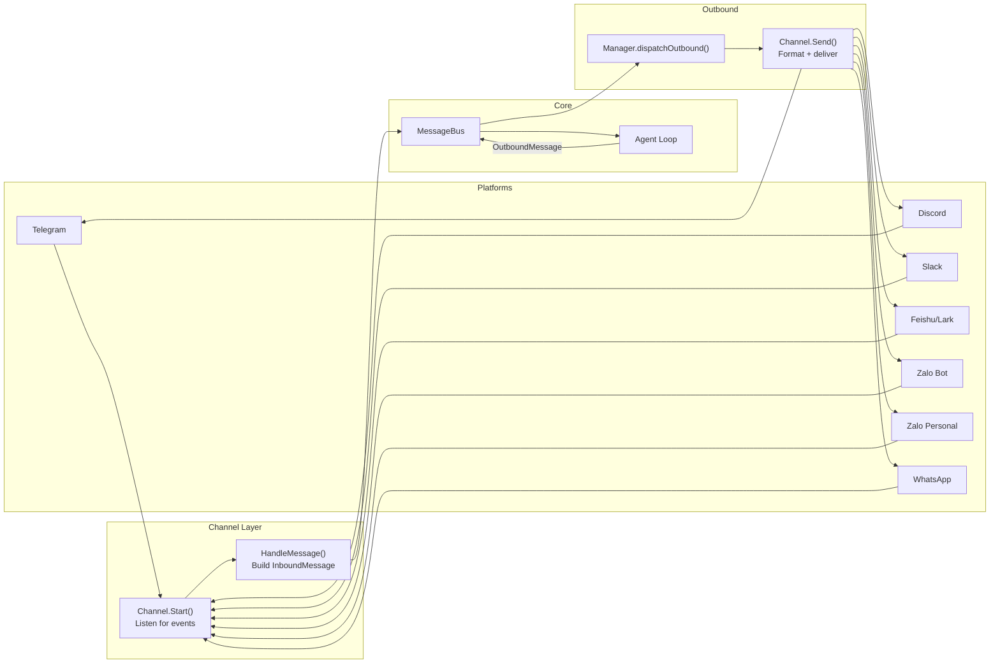
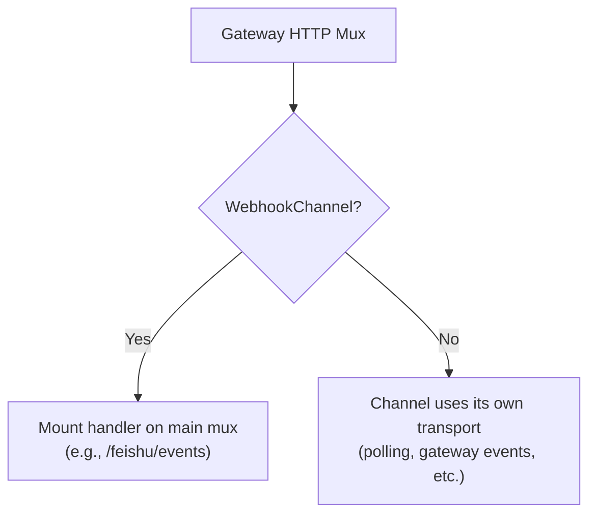
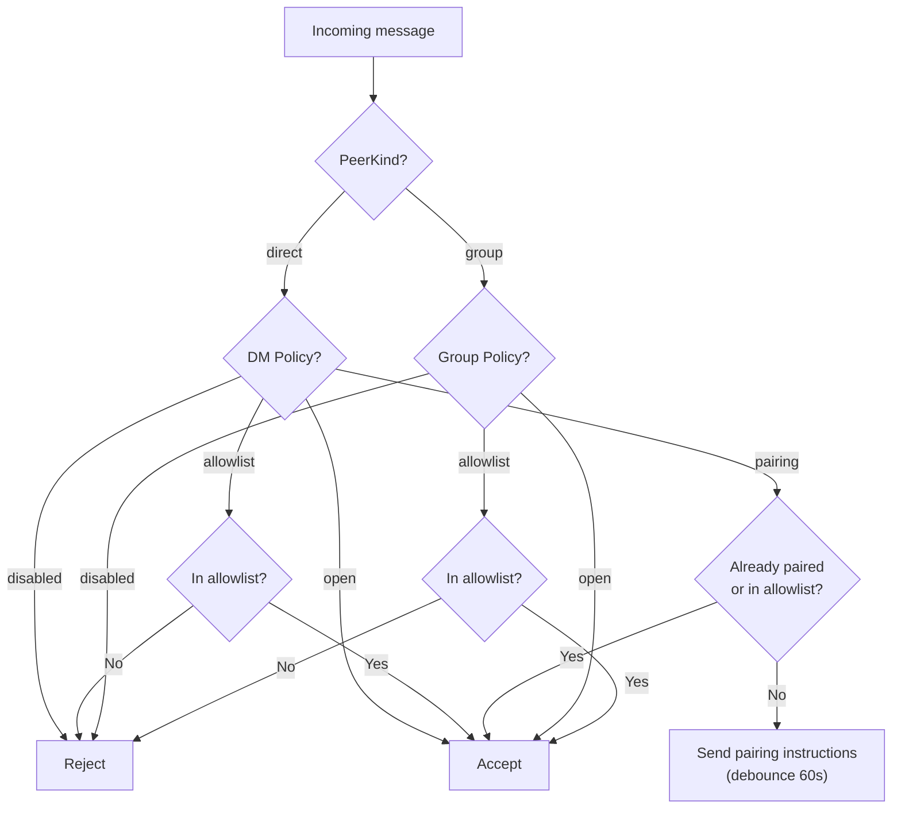
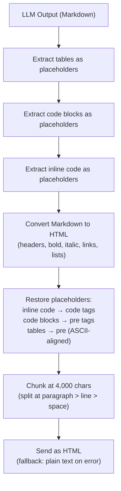
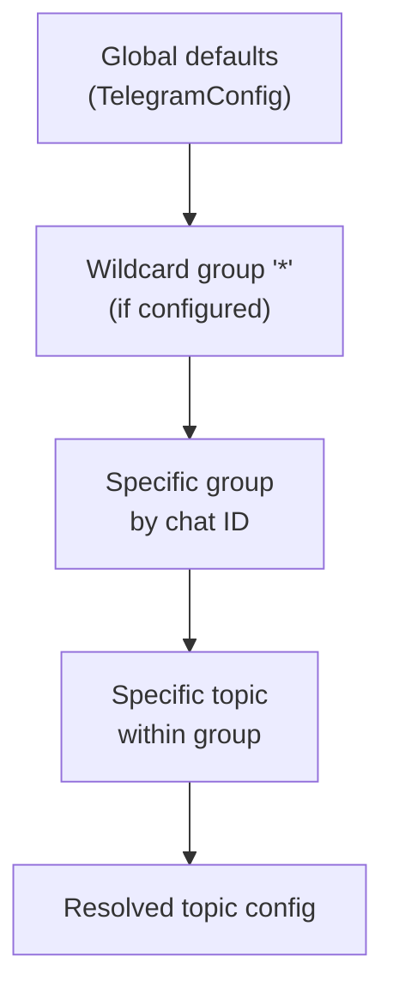
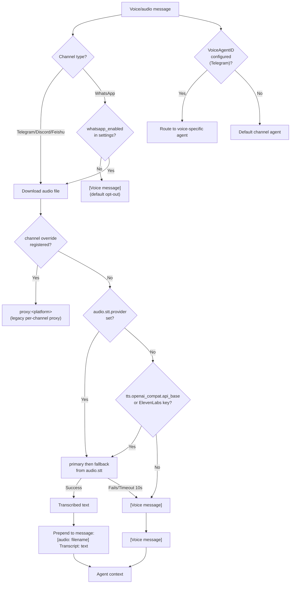
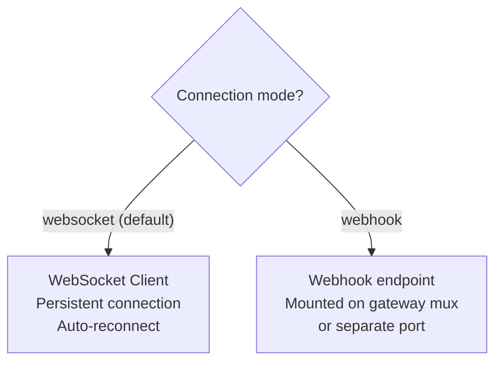
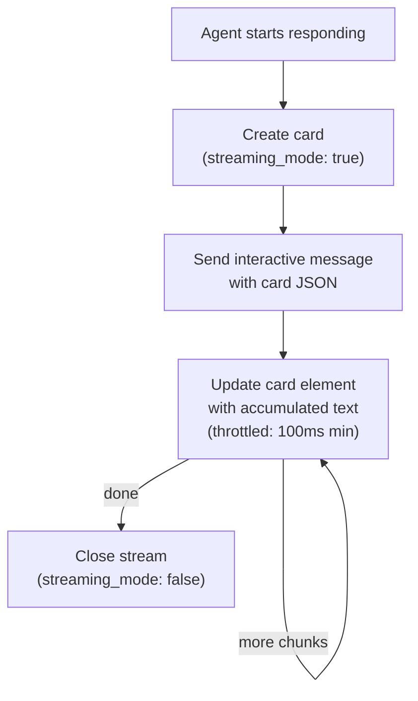
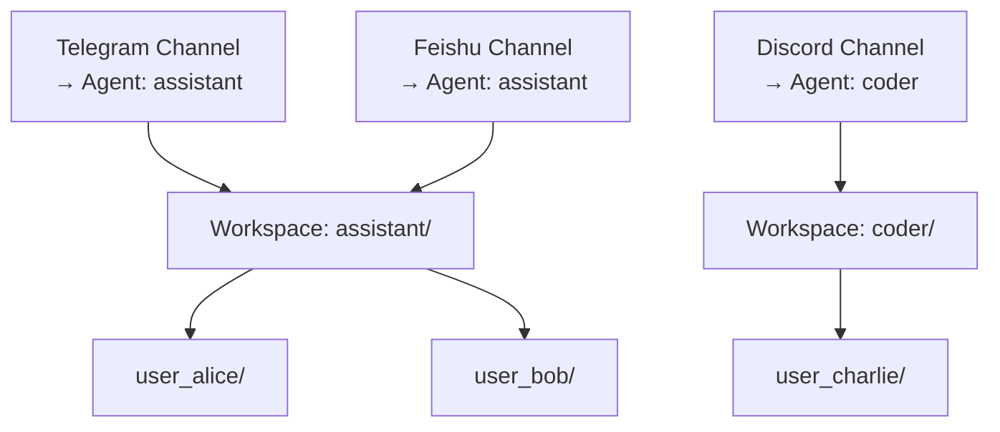
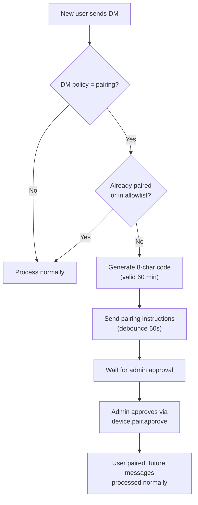

# 05 - Channels and Messaging

Channels connect external messaging platforms to the GoClaw agent runtime via a shared message bus. Each channel implementation translates platform-specific events into a unified `InboundMessage`, and converts agent responses into platform-appropriate outbound messages.

---

## 1. Message Flow



Internal channels (`cli`, `system`, `subagent`, `browser`) are silently skipped by the outbound dispatcher and never forwarded to external platforms. The `browser` channel uses WebSocket directly on the gateway connection.

### Message Routing Prefixes

The consumer routes system messages based on sender ID prefixes:

| Prefix | Route | Scheduler Lane |
|--------|-------|:-:|
| `subagent:` | Parent session queue | subagent |
| `delegate:` | Parent agent's original session (legacy session key format) | team |
| `teammate:` | Target agent session | team |

### Inbound Debounce

Normal channel messages pass through the shared inbound debouncer before agent execution. `gateway.inbound_debounce_ms` merges rapid text messages from the same `channel:chatID:senderID:agentID`; `0` means no debounce and positive values set the wait window. Agents can override the global value with `other_config.inbound_debounce_ms`; unset inherits the global config. Command/control messages such as `/stop`, `/reset`, and system escalations bypass the debouncer.

### Human-like Delivery

`gateway.chat_behavior` controls optional channel-only delivery polish. Delivery
text is not added to session history or the main provider messages.

- `quick_ack` sends one short receipt for non-streaming channel runs.
  `mode="sidecar_generated"` uses a bounded sidecar LLM call;
  `mode="llm_generated"` is kept as a backward-compatible alias;
  `mode="fixed_template"` sends the first template; `mode="off"` disables it.
- `quick_ack.provider/model` can choose a cheaper sidecar provider/model. If
  unset, the delivery generator falls back to the agent provider/model. Timeout,
  max token, and max char limits bound the call; templates are fallback output on
  errors, timeouts, or empty sidecar text.
- `intermediate_replies` sends sidecar-generated progress during tool phases. It
  is independent from `quick_ack`: either feature can be enabled or disabled
  alone.
- Sidecar progress uses bounded delivery metadata only: message preview, locale,
  channel/peer, agent label, and tool phase. It does not receive session
  history, tool arguments, tool output, tool schemas, memory, or system prompts.
- Deterministic Tool Status Messages no longer emit channel text. Platform
  reactions and explicit Show Reasoning delivery remain separate behavior.
- `final_split` splits long final text replies into a bounded number of
  paragraph messages.
- Override order is Channel > Agent > Workspace. Agent overrides live in
  `agents.other_config.delivery_behavior`; channel overrides continue under
  `chat_behavior`.
- Legacy `gateway.block_reply` and channel `block_reply` values are still read
  as inherited `intermediate_replies.enabled` defaults when the newer
  `chat_behavior.intermediate_replies.enabled` field is unset.

Splitting is intentionally conservative. Replies containing fenced code, tables, lists, quotes, JSON/XML-ish blocks, or URL-only paragraphs remain a single message. Media replies and streaming deliveries are not split.

Progress messages are not added to session history by this behavior. Existing run timeline handling for explicit `block.reply` remains unchanged.

### Outbound Media Delivery

Agent tools can queue media files through `Result.Media`; the consumer converts
those entries into `OutboundMessage.Media` and preserves file order, MIME type,
filename, and optional captions.

- `send_file` accepts either the legacy single `path` + optional `caption`, or
  `attachments: [{path, caption?}, ...]` for batch delivery of existing
  workspace files.
- Telegram groups compatible outbound media into `sendMediaGroup` album chunks
  of 2-10 items. Photo/video items can share a chunk; documents group only with
  documents; audio groups only with audio. Voice-mode audio, singleton chunks,
  oversized images sent as documents, and incompatible runs use the existing
  ordered single-send fallback.
- Discord already sends multiple files plus optional text in one message.
- Slack and other media-capable channels keep ordered fallback behavior unless
  their adapter advertises a stronger batch capability.

### Reasoning Delivery

Telegram channel config supports explicit reasoning delivery:

| `reasoning_delivery` | Behavior |
|----------------------|----------|
| `streaming_only` | Legacy behavior. Show model reasoning only in the live streaming lane. |
| `always_bubbles` | Force provider streaming internally and send reasoning as bounded channel bubbles, even when `dm_stream` / `group_stream` are off. |
| `off` | Suppress reasoning output in the channel. Traces and provider usage remain unaffected. |

Backward compatibility: if `reasoning_delivery` is missing, legacy `reasoning_stream=false` resolves to `off`; otherwise it resolves to `streaming_only`. Explicit `reasoning_delivery` always wins over the legacy boolean. Reasoning bubbles are delivery-only messages and are not added to assistant history.

**Multi-attachment coalescing (#63).** Messages carrying attachments do NOT bypass the debouncer — that pre-fix shortcut was the source of N-replies for one user action. Instead, when media is present the effective window is `max(configured, mediaFloor)` so multi-file uploads land in the same buffer and flush together. Three surfaces apply the same invariant:

| Surface | Buffer key | Trigger |
|---------|------------|---------|
| `internal/bus/inbound_debounce.go` | `(channel, chatID, senderID, agentID)` | Any inbound passing through the shared bus |
| `internal/gateway/methods/chat_debounce.go` | `(userKey, sessionKey)` | `/v1/chat/completions` streaming sessions |
| `internal/channels/telegram/album_aggregator.go` | `(chatID, MediaGroupID)` | Telegram media-group updates (album = N updates sharing one `MediaGroupID`) |

The Telegram album aggregator runs at the channel layer after all access gates (mention, pairing, allow-list) pass — it buffers per `MediaGroupID`, pins the sender on first arrival as a security tripwire (mismatched sender → `security.album_sender_mismatch` + drop), and dispatches ONE call to the downstream pipeline on a 500ms silence window. `Channel.Stop()` synchronously drains pending albums before `pollCancel` so in-flight bursts always reach the agent loop. See `CONTRIBUTING.md` → "Multi-attachment coalescing" for the eight cross-surface invariants any new surface must honor.

---

## 2. Channel Interfaces

Every channel must implement the base interface:

| Method | Description |
|--------|-------------|
| `Name()` | Channel instance name (e.g., `"telegram"`, `"discord"`) |
| `Type()` | Platform type identifier (e.g., `"telegram"`, `"zalo_personal"`). For config-based channels equals `Name()`; for DB instances may differ. |
| `Start(ctx)` | Begin listening for messages (non-blocking) |
| `Stop(ctx)` | Graceful shutdown |
| `Send(ctx, msg)` | Deliver an outbound message to the platform |
| `IsRunning()` | Whether the channel is actively processing |
| `IsAllowed(senderID)` | Check if a sender passes the allowlist |

### Extended Interfaces

| Interface | Purpose | Implemented By |
|-----------|---------|----------------|
| `StreamingChannel` | Real-time streaming updates | Telegram, Slack |
| `WebhookChannel` | Webhook HTTP handler mounting | Facebook, Feishu/Lark, Pancake |
| `ReactionChannel` | Status reactions on messages | Telegram, Slack, Feishu |
| `ActivityIndicatorChannel` | Ephemeral "agent is working" indicator | Bitrix24, WeChat |
| `BlockReplyChannel` | Override gateway block_reply setting | Discord, Feishu/Lark, Pancake, QQ, Slack, Zalo Bot, Zalo Personal |
| `ChatBehaviorChannel` | Override gateway chat_behavior setting | Bitrix24, Discord, Feishu/Lark, Pancake, QQ, Slack, Telegram, WhatsApp, Zalo Bot, Zalo Personal |
| `ReasoningDeliveryChannel` | Override channel-visible reasoning delivery | Telegram |

`BaseChannel` provides a shared implementation that all channels embed: allowlist matching, `HandleMessage()`, `CheckPolicy()`, and user ID extraction.

### Activity Indicator (`ActivityIndicatorChannel`)

Shows a native, ephemeral "agent is working" indicator while the agent thinks or runs tools,
so users on non-streaming channels aren't left staring at silence until the final reply. It is
**not** a chat message — nothing is persisted, no extra LLM call is made.

Driven by the existing agent event stream in `Manager.HandleAgentEvent`:

- `run.started` → `THINKING`, and a conditional heartbeat ticker starts.
- `tool.call` → status mapped from the tool name (`SEARCHING`, `READING_DOCS`, `GENERATING`,
  `CONNECTING`, `PROCESSING`) via `resolveToolActivityStatus`.
- `tool.result` → `ANALYZING`.
- terminal events → ticker stops.

Because non-streaming turns emit no events during LLM inference, a **conditional heartbeat
ticker** re-sends the current status only when the run has been idle beyond a threshold — filling
the gap without spamming. Calls are **best-effort and dropped on rate limit** (they never retry
into the portal's leaky bucket, so real message sends are never starved).

**Bitrix24** implements it via `imbot.v2.Chat.InputAction.notify` (status codes
`IMBOT_AGENT_ACTION_*`). Toggle per channel with `activity_indicator` (default on).

**WeChat** implements it through iLink's `sendtyping`, which first needs a per-peer
`typing_ticket` from `getconfig`; tickets are cached for 24 h, the indicator is cancelled once
the reply has been delivered, and a peer whose ticket cannot be fetched simply shows no
indicator rather than failing the run.

### Webhook Mount

Channels implementing `WebhookChannel` expose an HTTP handler that can be mounted on the gateway's main HTTP mux. This enables single-port operation — no separate webhook server needed.



---

## 3. Channel Policy

### DM Policies

| Policy | Behavior |
|--------|----------|
| `pairing` | Require pairing code for new senders |
| `allowlist` | Only whitelisted senders accepted |
| `open` | Accept all DMs |
| `disabled` | Reject all DMs |

### Group Policies

| Policy | Behavior |
|--------|----------|
| `open` | Accept all group messages |
| `allowlist` | Only whitelisted groups accepted |
| `disabled` | No group messages processed |

### Policy Evaluation



---

## 4. Channel Comparison

| Feature | Telegram | Feishu/Lark | Discord | Slack | WhatsApp | Zalo Bot | Zalo Personal | Bitrix24 | QQ | WeChat |
|---------|----------|-------------|---------|-------|----------|---------|---------------|----------|-----|--------|
| Connection | Long polling | WS (default) / Webhook | Gateway events | Socket Mode | Direct protocol (in-process) | Long polling | Internal protocol | Long polling (REST) | WebSocket (outbound only) | Long polling (outbound only) |
| DM support | Yes | Yes | Yes | Yes | Yes | Yes (DM only) | Yes | Yes | Yes | Yes (replies only — cannot open a conversation) |
| Group support | Yes (mention gating) | Yes | Yes | Yes (mention gating + thread cache) | Yes | No | Yes | Yes | Yes (mention gating) | No (reply reference is per peer) |
| Forum/Topics | Yes (per-topic config) | Yes (topic session mode) | -- | -- | -- | -- | -- | -- | -- | -- |
| Message limit | 4,096 chars | Configurable (default 4,000) | 2,000 chars | 4,000 chars | WhatsApp native limit | 2,000 chars | 2,000 chars | 4,096 chars | Configurable (default 1,500; QQ publishes no limit) | Configurable (default 4,000; iLink publishes no limit) |
| Streaming | Typing indicator | Streaming message cards | Edit "Thinking..." | Edit "Thinking..." (throttled 1s) | No | No | No | No | No | Typing indicator |
| Media | Photos, voice, files | Images, files (30 MB) | Files, embeds | Files (download w/ SSRF protection) | Images, audio, video, documents | Images (5 MB) | -- | Files (20 MB default) | Inbound yes (20 MB cap, SSRF + redirect-hop checked); outbound yes — base64 `file_data` upload + `msg_type=7`, voice renders as a voice bar. Local paths only, no remote `media_url` fetch | Inbound yes (encrypted CDN, host-pinned, 25 MB × 4, 45 s); outbound yes — `getuploadurl` slot + AES-ECB upload, image/video/file (voice travels as a file card). Local paths only |
| Speech-to-text | Yes | Yes | Yes | -- | Yes (opt-in) | -- | -- | -- | Yes (needs a SILK decoder on the host) | Yes — iLink's own `voice_item.text` first, GoClaw's ASR chain only when it is absent (also needs the host SILK decoder) |
| Voice routing | Yes (VoiceAgentID) | -- | -- | -- | -- | -- | -- | -- | -- | -- |
| Rich formatting | Markdown → HTML | Card messages | Markdown | Markdown → mrkdwn | Plain text | Plain text | Plain text | Plain text | Plain text (markdown msg_type not wired yet) | Plain text |
| Bot commands | 10+ commands | -- | -- | -- | -- | -- | -- | -- | -- | -- |
| Tool allow list | Per-topic | -- | -- | -- | -- | -- | -- | -- | -- | -- |
| Pairing support | Yes | Yes | Yes | Yes | Yes | Yes | Yes | Yes | Yes (separate C2C and per-group identities) | Yes |
| Status reactions | Yes | Yes | -- | Yes | -- | -- | -- | -- | -- | -- |

---

## 5. Telegram

The Telegram channel uses long polling via the `telego` library (Telegram Bot API).

### Core Behaviors

- **Group mention gating**: By default, bot must be @mentioned in groups (`requireMention: true`). Pending messages without a mention are stored in a history buffer (default 50 messages) and included as context when the bot is eventually mentioned.
- **Typing indicator**: A "typing" action is sent while the agent is processing.
- **Proxy support**: Optional HTTP proxy configured via channel config.
- **Cancel commands**: `/stop` and `/stopall` intercepted before the 800ms debouncer. See [08-scheduling-cron.md](./08-scheduling-cron.md) for details.
- **Concurrent group support**: Group sessions support up to 3 concurrent agent runs.
- **Bot reply as implicit mention**: Replying to a bot message in a group counts as mentioning the bot.
- **Show Reasoning delivery**: `reasoning_delivery=always_bubbles` decouples provider streaming from Telegram live streaming so reasoning can appear as bounded normal messages while the final answer remains non-streaming.

### Formatting Pipeline



Tables are rendered as ASCII-aligned text inside `<pre>` tags. CJK and emoji characters are counted as 2-column width for proper alignment.

### Forum Topics

Telegram forum topics (supergroup threads) get per-topic configuration with layered merging.



**Configurable per topic:**

| Field | Description |
|-------|-------------|
| `groupPolicy` | open, allowlist, pairing, disabled |
| `requireMention` | Override mention gating for this topic |
| `allowFrom` | User/ID allowlist for this topic |
| `enabled` | Enable/disable this specific topic |
| `skills` | Override available skills (nil=inherit, []=none, ["x","y"]=whitelist) |
| `tools` | Override available tools (supports `group:xxx` syntax) |
| `systemPrompt` | Additional system prompt (concatenated at topic level) |

**Session key format:**

| Context | Key Format |
|---------|------------|
| Regular chat | `"-12345"` |
| Forum topic | `"-12345:topic:99"` |
| DM thread | `"-12345:thread:55"` |

General topic (ID=1) is stripped during send — Telegram API requires no thread ID for the general topic. Deleted topics are detected via error message matching and retried without the thread ID.

### Tool Allow List (Per-Topic)

Each topic can restrict which tools the agent may use. The `tools` field accepts tool names and group references:

- `nil` = inherit all tools (no restriction)
- `[]` = no tools for this topic
- `["web_search", "group:fs"]` = only web search and filesystem tools

The tool allow list is passed via message metadata and applied by the policy engine before the LLM sees the tool definitions.

### Voice Message Transcription (STT)

Voice and audio messages are transcribed through a unified `audio.Manager` interface. Six
channels route transcription through the same STT chain today — Telegram, Discord, Feishu,
WhatsApp (opt-in), QQ and WeChat — and each of them must first download the audio, because every
provider uploads a file rather than handing the engine a URL. Slack, Bitrix24, Facebook, Pancake,
both Zalo adapters and the webchat/WS upload path download or classify audio and tag it but never
transcribe. QQ and WeChat voice is SILK, so those two additionally need a host-installed decoder
(see below); WeChat uses iLink's own `voice_item.text` whenever it is present and spends an ASR
call only when it is not.

#### Unified STT Flow



#### Configuration & Decision Rules

**Resolution order** (`internal/audio/manager_stt.go`): (1) a provider registered for the calling
channel — the legacy `channels.<x>.stt_proxy_url` bridge registers `proxy:telegram`, `proxy:feishu`
and `proxy:discord`, which is reached because those channels put their platform name in the context
with `audio.WithChannel`; (2) the chain built from `audio.stt`; (3) `elevenlabs → proxy`, filtered
to what actually registered. Unregistered names are dropped at resolution rather than walked and
warned about on every voice message.

| Config | Effect |
|--------|--------|
| `audio.stt.provider` set | That provider — plus optional `audio.stt.fallback` — is the chain. The TTS-derived sources are not consulted. |
| provider empty, `tts.openai_compat.api_base` or an ElevenLabs TTS key present | Historical behavior preserved: that endpoint becomes the chain |
| neither | `STTAvailable(ctx)` is false; channels leave the voice untranscribed and log at Debug instead of failing per message |
| `audio.stt.timeout_ms` | Per-call deadline for one transcription (`Manager.STTTimeout(fallback)`). Unset keeps each channel's own default (10 s today). QQ and WeChat wrap their whole media step in a wider budget, and that outer bound still wins. |
| `audio.stt.silk_decoder` | Pins the SILK binary outside `PATH`; `off` stops the search. Seeded into `system_configs` like the rest of the STT keys. |
| `channels.<x>.stt_proxy_url` | A proxy scoped to that platform, tried before the global chain for it (deprecated, warns once) |

`provider` names a protocol, not a vendor: `openai_compat` covers SiliconFlow, a self-hosted
whisper server and OpenAI itself, and the service is chosen by `base_url`. Supported values are
`openai_compat`, `elevenlabs`, `proxy`; anything else registers nothing and says so at startup.
`model` is sent to the primary only — a fallback keeps its own default, because one engine's model
id means nothing to another. The `proxy` protocol is a file in and a `{"transcript": …}` out: it has
no field for a model or a language hint, so choosing `proxy` with those set logs it at Debug rather
than pretending the hint was applied. `api_key` is stored in the encrypted `config_secrets` table
(masked in `config.get`, never written to config.json) and `GOCLAW_AUDIO_STT_API_KEY` overrides it.

**Where it is edited.** Web: **Config → Integrations → Speech-to-Text**
(`ui/web/src/pages/config/sections/stt-section.tsx`). Desktop: **Built-in tools → stt → Settings**,
which patches `audio.stt` over the same WS methods the web panel uses
(`ui/desktop/frontend/src/hooks/use-stt-config.ts`) — there is no Integrations screen in the
desktop build, and channels do run there, so this is its only STT surface.

`builtin_tools[stt].settings` carries exactly one flag the chain consults: `whatsapp_enabled`.
Both dialogs used to offer a provider list, an ElevenLabs key and a proxy URL in that blob, which
nothing ever read — a configured-looking form that changed nothing, including a voice message that
never got transcribed. Those fields are gone: the web dialog is the WhatsApp opt-in plus a pointer
to the real card, and the desktop dialog is the real `audio.stt` editor.

**Restart:** the audio Manager is built during startup, before any channel starts, so a change to
STT config takes effect on restart.

**Decision 6 (WhatsApp opt-in):** WhatsApp voice message STT is **OFF by default** (`whatsapp_enabled: false`). Rationale: WhatsApp voice messages are end-to-end encrypted; sending audio to an external STT provider breaks E2E encryption. Admins must explicitly toggle it in the UI at **Builtin tools → stt → WhatsApp voice transcription** and acknowledge the E2E breaking change. This opt-in is the one STT setting still read from `builtin_tools[stt]`, and it stays deliberately conservative: WhatsApp is the only channel where transcribing voice weakens a platform guarantee.

When disabled (default):
- Voice messages surface in agent context as `[Voice message]` (localized via i18n key `channel.voice_message_fallback`)
- No audio leaves the device

When enabled:
- Voice audio is transcribed via the configured STT chain
- Fallback to `[Voice message]` on failure/timeout (10s wall clock)

#### Per-Channel Behavior

| Channel | STT Support | Notes |
|---------|:-:|---------|
| **Telegram** | Yes | Uses unified chain; preserves Telegram voice MIME; legacy proxy override is keyed by platform type `telegram`; voice routing via `VoiceAgentID` config |
| **Discord** | Yes | Standard flow; the download comes from Discord's CDN, which is trusted rather than SSRF-screened |
| **Feishu** | Yes | Standard flow; audio arrives as opus and is saved to a temp file |
| **WhatsApp** | Yes (opt-in) | Requires explicit admin approval; default OFF (E2E trade-off) |
| **Slack** | No | Downloads audio and tags `<media:audio>`; nothing calls `Transcribe` |
| **Zalo (OA)** | No | The wire parser has no audio field at all |
| **Zalo (personal)** | No | Audio is classified by MIME and downloaded (SSRF-checked), but not transcribed |
| **Bitrix24** | No | Downloads portal files and tags them; no STT call |
| QQ | Yes | Downloads attachments after the policy gates; voice transcribed if a SILK decoder exists on the host |
| **WeChat** | Platform-side, with our own fallback | iLink's `voice_item.text` is used when present; when it is absent the SILK blob is fetched from the encrypted CDN and transcribed by the configured ASR chain, which needs a host SILK decoder like QQ voice does |

#### Factory Integration

Six factories take the `audio.Manager`; the rest of them do not, because they cannot transcribe:
- Telegram: `FactoryWithStoresAndAudio(..., audioMgr)`
- Discord: `FactoryWithStoresAndAudio(..., audioMgr)`
- Feishu: `FactoryWithStoresAndAudio(..., audioMgr)`
- WhatsApp: `FactoryWithDBAudio(..., audioMgr, builtinToolStore)`
- QQ: `qqchannel.FactoryWithAudio(audioMgr)`
- WeChat: `weixinchannel.FactoryWithAudio(audioMgr)`

`zalo`, `zalo/personal`, `slack`, `facebook`, `pancake` and `bitrix24` factories take no audio
manager at all (registration list in `cmd/gateway.go:943-969`), which is the cheapest way to tell
whether a channel can transcribe.
WhatsApp additionally accepts `builtinToolStore store.BuiltinToolStore` to fetch the per-message `whatsapp_enabled` opt-in flag. Wiring is in `cmd/gateway_channels_setup.go` and `cmd/gateway.go`.

### Bot Commands

Commands are processed before enriching content with reply/forward context (to prevent parsing issues).

| Command | Description | Group Restriction |
|---------|-------------|:-:|
| `/help` | Show command list | -- |
| `/start` | Passthrough to agent | -- |
| `/stop` | Cancel current run | -- |
| `/stopall` | Cancel all runs | -- |
| `/reset` | Clear session history | Writers only |
| `/status` | Bot status + username | -- |
| `/tasks` | Team task list | -- |
| `/task_detail <id>` | View task detail | -- |
| `/addwriter` | Add group file writer (reply to target user) | Writers only |
| `/removewriter` | Remove group file writer | Writers only |
| `/writers` | List group file writers | -- |

### Group File Writer Restrictions

In group chats, write-sensitive operations (file writes, `/reset`) are restricted to designated writers. The group ID format is `group:telegram:{chatID}`.

- Permission check queries the database: `IsGroupFileWriter(agentID, groupID, senderID)`
- Fail-open on database errors (security logged as `security.reset_writer_check_failed`)
- Writers are managed via `/addwriter` and `/removewriter` commands

---

## 6. Feishu/Lark

The Feishu/Lark channel connects via native HTTP with two transport modes.

### Transport Modes



When using webhook mode with port=0, the handler is mounted directly on the gateway's main HTTP mux (see webhook mount in Section 2). If a separate port is configured, a dedicated server is started.

### Configuration

| Field | Default | Description |
|-------|---------|-------------|
| `ConnectionMode` | `"websocket"` | `"websocket"` or `"webhook"` |
| `WebhookPort` | 0 | 0 = mount on gateway mux; >0 = separate server |
| `WebhookPath` | `"/feishu/events"` | Webhook endpoint path |
| `RenderMode` | `"auto"` | `"auto"` (detect code/tables), `"card"`, or default text |
| `TextChunkLimit` | 4,000 | Max characters per text message |
| `MediaMaxMB` | 30 | Max file size for media (MB) |
| `TopicSessionMode` | disabled | `"enabled"` for thread-per-topic session isolation |
| `RequireMention` | true | Require bot mention in group |
| `GroupAllowFrom` | -- | Group-level allowlist (separate from DM) |
| `ReactionLevel` | -- | `"off"`, `"minimal"` (terminal only), or full |

### Streaming Message Cards

Responses are delivered as interactive card messages with real-time streaming updates.



Each update increments a sequence number for ordering. Updates are throttled at 100ms minimum intervals to avoid API rate limiting. The streaming card displays content with a print animation effect (50ms frequency, 2-character steps).

### Media Handling

**Receive (inbound)**: Images, files, audio, video, and stickers are downloaded from the Feishu API with configurable size limits (default 30 MB). Oversized files are silently skipped.

| Media Type | Saved As |
|------------|----------|
| Image | `.png` |
| File | Original extension |
| Audio | `.opus` |
| Video | `.mp4` |
| Sticker | `.png` |

**Filename preservation**: When a user uploads or shares a file with a recognizable name, the channel adapter populates `bus.MediaFile.Filename` with the original filename (e.g., Feishu file display name, Telegram `file_name`). This filename is then sanitized and persisted to disk in the format `{stem}-{8hex}{ext}` (e.g., `báo-cáo-2024-a1b2c3d4.pdf` → `bao-cao-2024-a1b2c3d4.pdf`). The sanitizer supports Vietnamese diacritics, CJK scripts, and filesystem safety. Media without a user-provided filename (voice notes, clipboard pastes) fall back to UUID-only names. Disk names with semantic stems enable vault enrichment to process documents contextually. See `internal/agent/media_filename.go` for sanitization rules.

**Send (outbound)**: Files are uploaded to Feishu with automatic type detection (opus, mp4, pdf, doc, xls, ppt, or generic stream).

### Mention Resolution

Feishu sends content with placeholder tokens (e.g., `@_user_1`) for mentioned users. GoClaw processes these:

- **Bot mentions**: Stripped entirely (just the trigger, not meaningful content)
- **User mentions**: Replaced with `@DisplayName` from the mention list
- Fallback detection when bot ID is unknown

### Topic Session Mode

When enabled, each thread gets an isolated session:
- Session key includes the thread root message ID: `"{chatID}:topic:{rootID}"`
- Different threads within the same group maintain separate conversation histories
- Disabled by default

### Thread Reply Routing

When a message is sent inside a Lark thread (detected via the `thread_id` field in the inbound event), the inbound handler stamps `metadata["feishu_reply_target_id"]` with the triggering message ID. During outbound delivery, the channel routes responses back to the same thread using `LarkClient.ReplyMessage()` which POSTs to `/open-apis/im/v1/messages/{message_id}/reply` with `reply_in_thread: true`.

- **Automatic thread detection**: No configuration needed; replies are routed based on inbound `thread_id`
- **Metadata propagation**: The `feishu_reply_target_id` key is included in the `routingMetaKeys` allowlist so replies, block replies, and placeholder updates all land in the correct thread
- **Graceful fallback**: If the reply endpoint fails (e.g., thread root deleted), the channel falls back to `SendMessage()` for the regular chat
- **Applies to**: Text, card, image, and file messages

### Document URL Auto-Fetch

When a user pastes a Lark docx (document) URL in a message, the channel automatically fetches the document raw text and injects it into the agent prompt for context.

**URL detection**: Regex pattern matches `https://*.larksuite.com/docx/<id>` and `*.feishu.cn/docx/<id>` URLs.

**Auto-fetch behavior**:
- Document content fetched via Lark API `GET /open-apis/docx/v1/documents/{id}/raw_content`
- Content injected as `[Lark Doc: <url>] ... [End of Lark Doc]` markers around the raw text
- Rune-safe truncation at 8000 runes per document to respect token budgets
- Results cached per channel instance with LRU eviction (128 entries, 5-minute TTL)

**Access control**: Requires bot app to have `docx:document:readonly` permission **and** document owner must explicitly grant the bot access to each document. If access is denied or document not found, a visible inline marker appears: `[Lark Doc X: access denied — grant the bot app read permission on this document]`

**Safeguards**:
- Limited to docx documents only (sheets, base, wiki deferred)
- Maximum 10 document fetches per inbound message (spam protection)
- Soft-fail on API errors (no outbound message blocks)

**Configuration**: No new config flags. Supported document type and cache tunables (8000 rune limit, 10-URL cap, 5-min TTL, 128-entry cache) are hardcoded.

### Writer Management Commands

Group chats support file-write permission management via slash commands. Permissions are scoped to the group via `group:feishu:<chatID>`. DM users who attempt these commands receive a hint that they only work in groups.

**Commands** (group-only):

| Command | Description | Requires Target | Permission |
|---------|-------------|:---:|:---:|
| `/addwriter <@user or reply>` | Grant file_writer permission to target user | Yes | Writers only |
| `/removewriter <@user or reply>` | Revoke file_writer permission from target user | Yes | Writers only |
| `/writers` | List current group writers with displayName | No | -- |

**Target specification**: Commands require explicit identification via reply-to or @mention. Bare `/addwriter` without a target is rejected — prevents accidental privilege capture.

**Bootstrap behavior**: Groups with no writers allow the first writer to grant themselves via `/addwriter @self` (explicit self-mention). This enables initial configuration without external admin intervention.

**Authorization**:
- Only existing writers can manage the writer list (enforce via `IsGroupFileWriter` check)
- Last-writer guard: If removing a writer would leave zero writers, operation is rejected with user-facing message
- Database errors are fail-open; security issues are logged as `security.writer_check_failed`

**Implementation**: Timeout of 10 seconds bounds Feishu API calls. Requires `AgentStore` and `ConfigPermissionStore` wired to the Feishu channel via constructor options.

---

## 7. Discord

The Discord channel uses the `discordgo` library to connect via the Discord Gateway.

### Key Behaviors

- **Gateway intents**: Requests `GuildMessages`, `DirectMessages`, and `MessageContent` intents
- **Message limit**: 2,000-character limit with automatic splitting at newlines
- **Placeholder editing**: Sends "Thinking..." → edits with actual response
- **Mention gating**: `requireMention` default true; bot mention stripped from content
- **Bot identity**: Fetches `@me` on startup to detect and ignore own messages
- **Typing indicator**: 9-second keepalive while agent processes
- **Group history**: Pending message buffer for context when mentioned
- **Thread backfill**: When the bot is mentioned inside a Discord thread, the channel fetches up to 25 prior thread messages before the triggering message through Discord REST, prepends their text as context, and downloads up to 15 prior attachments for the same inbound media pipeline. This is thread-only, bounded to 5 MB per backfilled file with a 30-second timeout, and gracefully falls back to the current message when Discord lacks `READ_MESSAGE_HISTORY` or the REST request fails.
- **Thread presentation titles**: Where a Discord thread is presented as the current chat, a session, a contact, or a delivery target, its label may be qualified as `thread / parent channel`. This is display-only; routing and selection continue to use stable IDs.
- **Metadata refresh**: Refreshing the contact cache unions the Discord group IDs stored in contacts with group and parent IDs retained by pending-message history. It directly looks up targets not already resolved from the live guild/channel state, so titles and parent metadata can be backfilled for inactive or archived threads when Discord returns them. The API response includes per-source coverage and individual failures; the gateway emits an INFO summary for every refresh and WARN entries for individual lookup failures. If any target cannot be fetched (for example, it was deleted or the bot lacks permission), the refresh reports failure rather than false success.

---

## 8. Slack

The Slack channel uses the `slack-go/slack` library to connect via Socket Mode (WebSocket).

### Key Behaviors

- **Socket Mode**: Uses `xapp-` App-Level Token for WebSocket connection (no public URL needed)
- **Three token types**: `xoxb-` (Bot Token, required), `xapp-` (App-Level Token, required), `xoxp-` (User Token, optional for custom identity)
- **Token prefix validation**: Tokens validated at startup (`xoxb-`, `xapp-`, `xoxp-` prefixes)
- **Message limit**: 4,000-character limit with automatic splitting at newline boundaries
- **Placeholder editing**: Sends "Thinking..." → edits with actual response (same as Discord)
- **Mention gating**: `requireMention` default true; `<@botUserID>` stripped from content
- **Thread participation cache**: After bot replies in a thread, subsequent messages in that thread auto-trigger response without @mention (24h TTL)
- **Message dedup**: `channel+ts` key prevents duplicate processing on Socket Mode reconnect
- **Message debounce**: Per-thread batching of rapid messages (300ms default, configurable; `debounce_delay: 0` disables)
- **Dead socket classification**: Non-retryable auth errors (invalid_auth, token_revoked) fail fast instead of infinite reconnect
- **Streaming**: Edit-in-place via `chat.update` with 1000ms throttle (Slack Tier 3 rate limit)
- **Reactions**: Status emoji on user messages (thinking_face, hammer_and_wrench, white_check_mark, x, hourglass_flowing_sand)
- **SSRF protection**: File download hostname allowlist (*.slack.com, *.slack-edge.com, *.slack-files.com), auth token stripped on redirect
- **Health probe**: `auth.test()` with 2.5s timeout for monitoring integration

### Formatting Pipeline

```
LLM markdown → htmlTagsToMarkdown() → extractSlackTokens() → escapeHTMLEntities()
→ extractCodeBlocks() → convertTablesToCodeBlocks() → bold/strike/header/link conversion
→ restore tokens/code blocks → Slack mrkdwn
```

Key conversions: `**bold**` → `*bold*`, `~~strike~~` → `~strike~`, `[text](url)` → `<url|text>`, `# Header` → `*Header*`, tables → code blocks.

### Environment Variables

```
GOCLAW_SLACK_BOT_TOKEN   → channels.slack.bot_token
GOCLAW_SLACK_APP_TOKEN   → channels.slack.app_token
GOCLAW_SLACK_USER_TOKEN  → channels.slack.user_token (optional)
```

Auto-enables when both bot_token and app_token are set.

---

## 9. WhatsApp

The WhatsApp channel connects directly to the WhatsApp network via the multi-device protocol. Authentication state is stored in the database (PostgreSQL standard, SQLite for desktop edition).

### Key Behaviors

- **Direct connection**: In-process WhatsApp client (direct to WhatsApp servers, no external bridge)
- **Database auth store**: Persists auth state, keys, and device info in the database
- **QR code authentication**: Interactive QR code for initial pairing, served via WebSocket API
- **Auto-reconnect**: Built-in reconnection with exponential backoff
- **DM and group support**: Full group messaging with mention detection via JID format
- **Media handling**: Direct media download/upload to WhatsApp servers with type detection
- **Typing indicators**: Typing state managed per chat with auto-refresh
- **Group mention gating**: Detects when bot is mentioned via LID (Local ID) and JID (standard format)

---

## 10. Zalo Bot

The Zalo Bot channel uses the official Zalo Bot API via long polling. It connects to a Zalo bot created with Zalo Bot Manager/Creator and does not require a Zalo Official Account.

### Key Behaviors

- **DM only**: No group support. Only direct messages are processed
- **Text limit**: 2,000-character maximum per message
- **Long polling**: Default 30-second timeout, 5-second backoff on errors
- **Media**: Image support with 5 MB default limit
- **Default DM policy**: `"pairing"` (requires pairing code)
- **Pairing debounce**: 60-second debounce on pairing instructions

---

## 11. Zalo Personal

The Zalo Personal channel provides access to personal Zalo accounts using a reverse-engineered protocol. This is an unofficial integration.

### Key Differences from Zalo Bot

| Aspect | Zalo Bot | Zalo Personal |
|--------|---------|---------------|
| Protocol | Official Bot API | Reverse-engineered (zcago, MIT) |
| DM support | Yes | Yes |
| Group support | No | Yes |
| Default DM policy | `pairing` | `allowlist` (restrictive) |
| Default group policy | N/A | `allowlist` (restrictive) |
| Authentication | Bot credentials | Pre-loaded credentials or QR scan |
| Risk | None | Account may be locked/banned |

### Security Warning

Zalo Personal uses an unofficial, reverse-engineered protocol. The account used may be locked or banned by Zalo at any time. A security warning is logged on startup: `security.unofficial_api`.

### Resilience

- Maximum 10 restart attempts
- Exponential backoff up to 60 seconds
- Special handling for error code 3000: 60-second initial delay
- Typing controller per thread

---

## 12. Channel-Isolated Workspaces

Each channel instance can target a specific agent, providing workspace isolation across channels.



Channel instances are loaded from the database with their assigned agent ID. The agent key is resolved and propagated through the message pipeline, ensuring all filesystem tools, context files, and memory operations use the correct workspace.

---

## 13. Passive Memory Extraction

Passive channel memory is an opt-in per-channel feature. When enabled in
`channel_instances.config.passive_memory`, the gateway periodically reads the
existing tenant-scoped `channel_pending_messages` group buffers, redacts sensitive
content, asks the background LLM provider for durable fact candidates, and stores
only candidates in the review queue.

Default behavior is privacy-first:

- Disabled by default.
- Group-only in v1.
- Review mode enabled by default.
- Runs by manual trigger, message cap, or interval.
- New extraction tables store metadata, summaries, topics/entities, confidence,
  status, and redaction counts, but not raw message bodies.
- Tenant admins may append non-secret extraction instructions globally from
  `/config` with `system_configs["channel_memory.extraction.custom_prompt"]`,
  per channel with `channel_instances.config.passive_memory.custom_prompt`, and
  per Discord group/history key with
  `channel_instances.config.passive_memory.group_custom_prompts`. These prompts
  append after the built-in extraction instructions in global, channel, then
  group order; they do not replace redaction or strict JSON requirements.
- Discord extraction input includes best-effort channel context when available:
  channel/thread ID, channel name, parent channel, category, and history key.
  Lookup failures fall back to IDs and do not fail extraction.
- Discord passive-memory metadata retains raw `group_title` and
  `parent_group_title` as separate fields. A qualified thread label such as
  `thread / parent channel` is presentation-only and is not written back into
  either raw field.
- New Discord pending history rows include display name, handle when available,
  and stable Discord user ID in sender/reply labels to make extracted facts less
  ambiguous when display names change.

Approved items write an `episodic_summaries` row with `source_type='channel'`
and a deterministic `source_id`; existing consolidation workers then handle KG
promotion. Candidate `topics` and `entities` are forwarded to KG extraction as
disambiguation hints only; they do not create graph nodes or relations unless
the approved summary supports the fact. Reject/delete prevents later writes.
Delete also removes the linked episodic row when one exists; already-promoted KG
nodes are not synchronously deleted in v1.

---

## 14. Local Key Propagation

Thread/topic context is preserved through the entire message pipeline using a `local_key` in message metadata. This ensures subagent, delegation, and team message results land in the correct thread — not the root chat.

| Platform | Local Key Format |
|----------|-----------------|
| Telegram (chat) | `"-12345"` |
| Telegram (topic) | `"-12345:topic:99"` |
| Telegram (thread) | `"-12345:thread:55"` |
| Feishu (chat) | `"oc_xyz"` |
| Feishu (topic) | `"oc_xyz:topic:{root_msg_id}"` |

All channel state — placeholders, streams, reactions, typing controllers, thread IDs — is keyed by this composite `local_key`. When delegation or team messages complete, the `local_key` from the original message is preserved in metadata and used to route the response back to the correct location.

---

## 15. Per-User Isolation

Channels provide per-user isolation through compound sender IDs and context propagation:

- **User scoping**: Each channel constructs a compound sender ID (e.g., `telegram:123456`) which maps to a `user_id`. The session key format `agent:{agentId}:{channel}:direct:{peerId}` ensures each user has isolated conversation history per agent.
- **Context propagation**: `HandleMessage()` injects `AgentID`, `UserID`, and `AgentType` into the context. These flow to the ContextFileInterceptor, MemoryInterceptor, and per-user file seeding.
- **Pairing storage**: PostgreSQL (`pairing_requests` and `paired_devices` tables).
- **Session persistence**: PostgreSQL `sessions` table with write-behind caching.

---

## 16. Pairing System

The pairing system provides a DM authentication flow for channels using the `pairing` DM policy.



### Code Specification

| Aspect | Value |
|--------|-------|
| Length | 8 characters |
| Alphabet | `ABCDEFGHJKLMNPQRSTUVWXYZ23456789` (excludes ambiguous: 0, O, 1, I, L) |
| TTL | 60 minutes |
| Max pending per account | 3 |
| Reply debounce | 60 seconds per sender |

---

## 16. Bitrix24

The Bitrix24 channel connects to a Bitrix24 portal via the `imbot.v2.*` REST API. Authentication uses an app token with `imbot` scope.

### Key Behaviors

- **Text limit**: 4,096 characters per message with automatic splitting at newlines
- **Media support**: Both inbound and outbound file transfers with MIME preservation
- **Default DM policy**: `"pairing"` (requires pairing code)
- **Pairing debounce**: 60-second debounce on pairing instructions
- **Media max size**: Configurable `media_max_mb` (default 20 MB) applies symmetrically to inbound downloads and outbound uploads

### Inbound Media

When a user sends a file to the bot:
1. Resolve file metadata via `imbot.v2.File.download` → obtain one-time authenticated download URL
2. Stream file to temp directory, preserving MIME type
3. Forward to agent via `bus.MediaFile` with original filename
4. Agent pipeline routes to appropriate reader (`read_image`, `read_document`, `read_audio`, `read_video`)

**Configuration**: Size cap via `media_max_mb` (per `channel_instance` or config default). Oversized files are silently skipped (best-effort).

### Outbound Media

Agent-produced media files are uploaded to the chat via `imbot.v2.File.upload`:
1. Read file from workspace
2. Encode as base64
3. POST to `imbot.v2.File.upload` with bot ID and chat ID
4. Upload succeeds atomically: file is stored in portal Drive, attached to chat, and posted in a single REST call

**Configuration**: Size cap via same `media_max_mb` knob (symmetric with inbound).

### OAuth Scope

The bot app must have the `imbot` scope granted. The `disk` scope is **not** required — all file operations are scoped to the message thread context.

**Implementation**: `internal/channels/bitrix24/download.go` (inbound), `send_media.go` (outbound). New `BaseChannel.HandleMessageMedia()` method (in `internal/channels/channel.go`) centralizes media-aware message handling across all channels.

---

## 17. QQ Official Bot

`internal/channels/qq/` implements the QQ Open Platform bot API v2 over a single outbound
websocket. No public IP, no callback port, no webhook mode.

**Setup.** Create the bot on the QQ 开放平台 console, then add a channel instance of type
`qq` in the web UI with App ID + App Secret. Two console switches decide what the bot can
receive at all: message reception for C2C and group @ messages, and — separately —
"接收所有消息" if plain group chatter should also be pushed. The intent subscribed by GoClaw
is `GROUP_AND_C2C_EVENT` (1<<25), which carries both event families; the firehose is gated
by the console, not by an intent bit.

**Identity.** A person has a different identifier per scenario: `user_openid` in C2C and
`member_openid` within a group. GoClaw namespaces the sender key (`c2c:…` / `member:…`) so a
pairing recorded for one namespace can never be honoured as the other, and chat ids carry
`c2c:` / `grp:` because the two send endpoints are chosen by scenario, not by anything
readable in the id. Whether `member_openid` is stable across groups is not documented, so
nothing assumes it is — a group member is treated as a per-group person.

**Replies.** QQ accepts a passive reply only while the inbound `msg_id` is fresh and only a
few times per message. The docs disagree on the window (the group page says 5 minutes / 5
replies; the C2C page says both "60 minutes, 4 replies" and "msg_id valid 5 minutes" on the
same page), so the conservative pair is implemented: 5 minutes, 4 replies. When QQ rejects a
passive reply (`err_code` 40034128 / 40034005 / 304103 / 40034024) the text is resent as an
active message, which is subject to its own quota — unverified bots get 5/s and 30/min,
20/min per relationship, 1000/day per user or group. Success is judged by `err_code`, never
by `message`, per the docs' own warning.

**Inbound media (stage 2).** Each attachment's CDN URL is fetched — after the DM/group policy
gates, so a stranger cannot make the gateway pull URLs — into a temp file, classified by
`content_type` then by filename extension, and handed to the pipeline as a media tag. Voice goes
through the STT chain like every other channel. The URL is attacker-influenced data, so it is
SSRF-checked before the request **and at every redirect hop**, and the body is capped at 20 MB.
An attachment that cannot be fetched is still announced (`[附件 N 个未能获取: …]`) rather than
disappearing.

SILK is the catch: QQ voice is usually `slk`/`silk`, which no transcription engine reads and no
pure-Go decoder exists for. `internal/audio/silk.go` therefore shells out to a host-installed
`silk_v3_decoder` or `silk_decoder`. **`ffmpeg` is last in that search order and is a dead end on
this path**: ffmpeg cannot decode SILK, and the decoder is only invoked for a payload that actually
sniffs as SILK (`prepareSTTInput` gates on the `#!SILK_V3` magic), so the "it might rescue a
mislabeled AMR" role its comment claims never happens — on a host that has only ffmpeg, startup
announces *decoder available* and then fails every voice note. Install a real silk decoder; nothing
else works. With no decoder installed the message still reaches the agent — as an undecoded voice
file — which is the honest outcome of a missing external tool rather than a silent drop. Set
`audio.stt.silk_decoder` to pin a binary outside PATH, or `off` to stop the search.

**Outbound media (rich media upload).** `POST /v2/{users|groups}/{id}/files` accepts the bytes
directly (`file_data`, base64), so a gateway with no public address can still send attachments —
the note in earlier revisions of this file and of the docs, saying a QQ-fetchable `url` was
required, described the older endpoint contract and is corrected here. The flow is: upload with
`srv_send_msg=false` → `file_info` (+ `ttl`) → one `msg_type=7` message per attachment. Media goes
*out after* the text so the small passive-reply budget is spent answering the human first, and the
isolation rule still holds — a file uploaded through the group endpoint can only be sent to that
group, and vice versa for C2C.

`file_type` is 1 image / 2 video / 3 voice / 4 file. Only the formats QQ renders as a card are
claimed as such (jpg/png/gif/webp/bmp; mp4; and **silk, mp3, wav or ogg for voice**, which is what
lets a TTS reply arrive as a playable voice bar rather than an attachment to open); anything else
is sent deliberately as a file instead of risking an `850019` unsupported-format rejection. The
per-file ceiling here is 20 MB — the same as QQ's soft limit — because a base64 body means holding
the whole file in memory twice, and QQ's 200 MB hard ceiling is not a reason to do that to a
2 GB board. A failed attachment is announced (`[附件发送失败: …]`) rather than vanishing, and a
message whose text was empty and whose attachments all failed returns an error.

The field is sent as `media.file_info`. The docs' prose says `file_info` while a rendered example
on the send page spells it `fileinfo`; every other field on these endpoints is snake_case, so
snake_case is what is implemented. A `22006` ("消息类型与内容不匹配") on a media send means that
reading is wrong — not that the upload failed.

**TTS.** `tts.auto` applies on this channel too: a reply that should be spoken becomes a
`file_type=3` voice message through the path above, and the `[[tts]]` markers are stripped whether
or not audio was produced. A channel that never called the helper delivered those markers to the
user verbatim.

**Resilience.** Heartbeat interval arrives in the hello frame in milliseconds; a missing ACK
for two beats is treated as a dead socket. Close codes are classified: 4914/4915 (bot
delisted or banned) and 4013/4014 (intent missing or not approved) stop the reconnect loop
and surface the console action in the channel health detail, because retrying cannot fix
them; 4009 resumes with the stored session id and sequence, 4006/4007 identify fresh.
Inbound events are deduplicated by event id, since the docs state the same `msg_id` may be
pushed more than once.

---

## 18. WeChat (personal account, iLink)

`internal/channels/weixin/` talks to Tencent's official iLink (智联) bot API for a **personal**
WeChat account — `https://ilinkai.weixin.qq.com`, HTTP/JSON, long-polling `getupdates`, so no
public callback URL is required. This is the route chosen over 企业微信 and 公众号; the
grey-market protocols were not considered.

**Activation.** Add a channel instance of type `weixin` in the web UI; the wizard's auth step
asks iLink for a QR code, renders it as PNG, and polls the scan state, showing the peer that the
code was scanned before confirmation. On success the `bot_token`, `ilink_bot_id` and
`ilink_user_id` are written onto `channel_instances.credentials` (encrypted at rest) and the
instance is hot-loaded. A created-but-unscanned instance is a normal state: the factory returns
no channel and health reports missing credentials rather than a runtime failure. Activation can
also be driven over WS directly (`weixin.qr.start`, see [19-websocket-rpc.md](./19-websocket-rpc.md)).

A token is bound to one session, so re-scanning replaces the previous login; the reference
implementation documents the same constraint. A `-14` reply means that session is dead: the
channel parks itself for an hour instead of hammering an endpoint that will keep refusing it —
which is also how an account avoids attracting attention.

**The protocol's central limitation.** A reply must carry the `context_token` taken from the
message it answers, and that reference is only ever produced by an inbound (and goes stale after
roughly a day of peer inactivity). An iLink bot therefore **cannot start a conversation**: cron
reminders, heartbeat output and approval pushes have no address to send to. `Send` returns an
error naming that reason instead of dropping the text quietly, and the outbound dispatcher logs
the undeliverable message. Groups are out of scope for the same shape of reason — the reply
reference is per peer — and inbound group messages are dropped on receipt.

**State is files, not the database.** The poll cursor and the per-peer reply tokens live under
`state_dir` (default `~/.goclaw/data/channels/weixin/<kind>/<accountKey>.json`), written
atomically and keyed by `sha256(base_url|token)` so two weixin instances on one gateway can never
read each other's cursor. `state_dir` exists for disk-constrained or containerized deployments
that must point this elsewhere.

**Inbound media goes through the encrypted CDN.** Image, file, video and voice items are
downloaded, AES-ECB decrypted with the per-message key, and handed to the pipeline as ordinary
attachments. The placeholder is dropped for an item that was fetched and kept for one that was
not, so an agent is never told "nothing arrived" about a photo it can see, nor given silence
about one it cannot. Voice is the interesting case: iLink's own `voice_item.text` is used when it
is present (free, and already correct), and when it is missing the SILK blob is fetched and run
through GoClaw's ASR chain — which needs a host SILK decoder, exactly as QQ voice does. At most
four attachments per message and 25 MB per object are fetched, and the whole step is bounded to
45 s because long-polling is sequential and a slow CDN must not delay every other peer. Keys
arrive in three shapes (`aes_key` raw-16 base64, the same base64 of a 32-character hex string,
and `image_item.aeskey` in hex); an item whose advertised key cannot be parsed is left as a
placeholder rather than guessed at, and an item with no key at all is only accepted when its
bytes really sniff as the type it claims.

**Outbound media is the same CDN, in reverse.** The sequence is `POST ilink/bot/getuploadurl`
with a key *we* generate (hex, 16 bytes) and the size of the **padded ciphertext** rather than the
file, then POST the AES-ECB body to the slot that comes back, then reference it. The download
parameter does not arrive in the JSON — it is the `X-Encrypted-Param` **response header**, and a
first implementation that reads the body instead gets an upload that no message can cite. The
message then carries `media.encrypt_query_param` plus `aes_key` as base64 *of the hex string*,
which is the doubled shape inbound media already parses, so the two directions are asserted
against each other in tests rather than assumed. A slot is answered as
`{cdn_base_url}/upload?encrypted_query_param=…&filekey=…`, or as `upload_full_url` when the
service supplies one — and that absolute answer is host-pinned before anything is POSTed, exactly
like a peer-supplied `full_url` on the way in. One upload and one `sendmessage` per file, after the
text, under the same 45 s budget; 25 MB per object.

Only image (1), video (2) and file (3) are sent. The upload enum declares VOICE=4, and **no
implementation is known to use it**, so a TTS reply leaves as an mp3 file card: playable in the
client, and an honest answer to "say that in voice" — a claimed voice bar would be a guess at a
shape nobody has observed. `[[tts]]` markers are stripped whether or not audio was produced.
Anything not recognisably an image or an mp4 also goes out as a file, which is the one category
known to work for every format.

Attachments are local paths only: this adapter reads bytes from disk and does not fetch a remote
`media_url` on the send path, unlike telegram/discord/slack which hand the URL to their own
servers. That is a real divergence for `POST /v1/webhooks` callers on these two channel types, and
a refused attachment is announced (`[附件发送失败: …]`) with a filename rather than a path. A reply
made only of attachments that all failed returns an error.

**The CDN host is pinned.** Both directions only ever contact `cdn_base_url` (default
`https://novac2c.cdn.weixin.qq.com/c2c`, https except loopback); a peer-supplied `full_url` is
honored only when it names that same host, otherwise the object is rebuilt from its
`encrypted_query_param`, and redirects that leave the pinned host are refused after an SSRF check
on every hop. A client that follows `full_url` verbatim turns "fetch the attachment" into "fetch
whatever the peer names", which is how a metadata endpoint gets read — and the same argument
applies to an `upload_full_url` handed back by a service response, which is where the upload URL
comes from.

**Host pinning.** During the scan, iLink may route an account to a different cell and hand back a
`redirect_host`; that host comes from a remote response, so it is accepted only over https and
only under `*.weixin.qq.com`. `base_url` and `proxy` are operator settings (the same trust level
as every other channel's endpoint override) and are still scheme-pinned to http(s).

**Resilience.** Long-poll timeout defaults to 35 s with headroom; three consecutive failures back
off to 30 s. The cursor advances only after a batch has been handed to the bus, and a cursor file
that cannot be parsed is reported rather than silently treated as "no cursor", because that
mistake replays or skips a peer's history.

---

## File Reference

| Module | Path | Purpose |
|---|---|---|
| Channel core | `internal/channels/` | `Channel` interface, `BaseChannel` (incl. `HandleMessageMedia()` method), `Manager` (StartAll/StopAll), outbound dispatcher, DB instance loader |
| Platform adapters | `internal/channels/{telegram,feishu,discord,slack,whatsapp,zalo,bitrix24,qq,weixin}/` | Per-platform: message handling, formatting, streaming, reactions, media, pairing |
| QR activation RPC | `internal/channels/whatsapp/qr_methods.go`, `internal/channels/weixin/qr_methods.go`, `internal/channels/zalo/personal/zalomethods/qr.go` | Scan-to-activate flows that write credentials onto a channel instance |
| Bitrix24 media | `internal/channels/bitrix24/download.go`, `send_media.go` | Inbound file download via `imbot.v2.File.download`, outbound upload via `imbot.v2.File.upload` |
| QQ media | `internal/channels/qq/media.go`, `media_send.go` | Inbound CDN download + STT, outbound base64 `files` upload and `msg_type=7` sends |
| WeChat media | `internal/channels/weixin/media.go`, `media_out.go` | Encrypted-CDN download/decrypt, and the reverse: `getuploadurl` slot, AES-ECB upload, signed reference |
| Audio / STT | `internal/audio/` | Audio manager, STT chain resolution, legacy STT bridge |
| Pairing & routing | `internal/store/pg/pairing.go`, `cmd/gateway_consumer.go` | Pairing code persistence, inbound message routing and cancel interception |

Use `grep` or your editor's symbol search for specific files.

---

## Cross-References

| Document | Relevant Content |
|----------|-----------------|
| [00-architecture-overview.md](./00-architecture-overview.md) | Channel startup in gateway sequence |
| [03-tools-system.md](./03-tools-system.md) | Tool policy engine, per-request tool allow list |
| [08-scheduling-cron.md](./08-scheduling-cron.md) | /stop and /stopall commands, scheduler lanes, cron |
| [09-security.md](./09-security.md) | Group file writer restrictions, security logging |
| [11-agent-teams.md](./11-agent-teams.md) | Team message routing, delegation result delivery |
| [project-changelog.md](./project-changelog.md) | Phase 5 audio manager & unified STT implementation |
